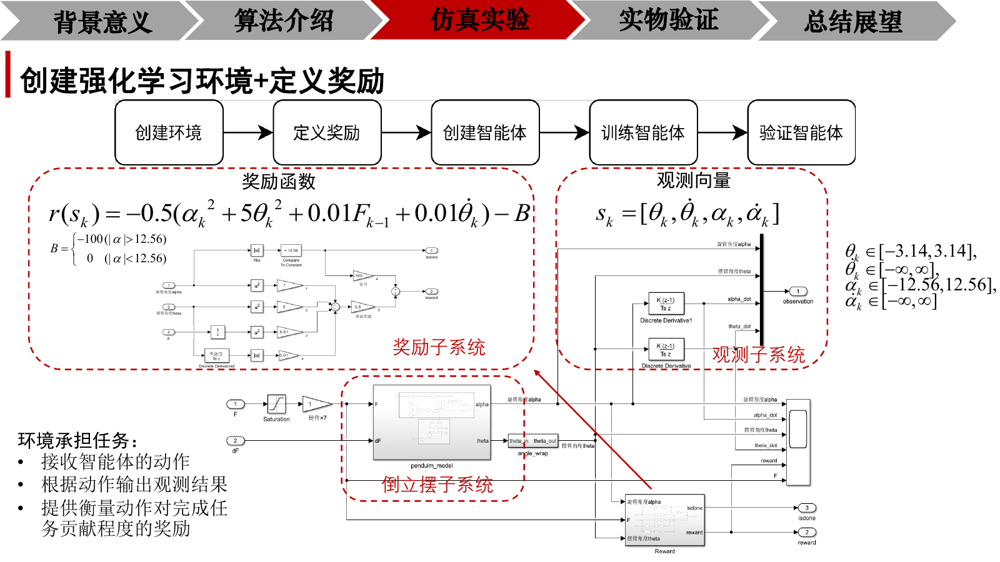
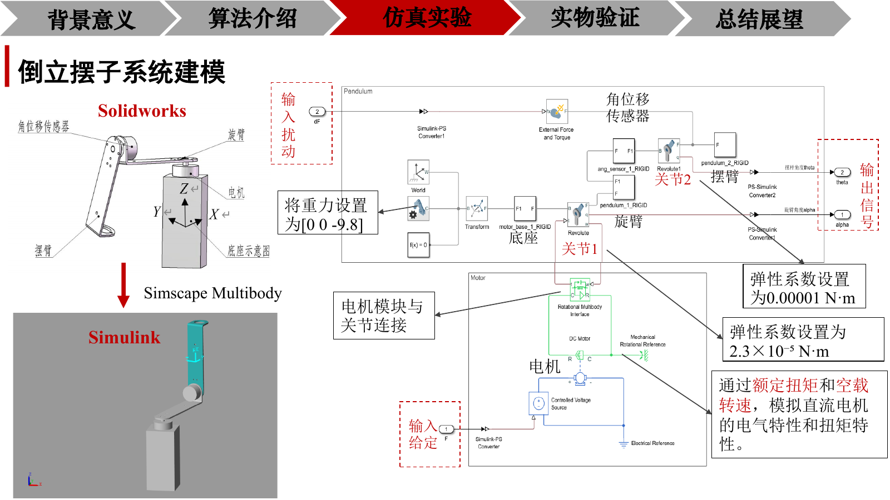
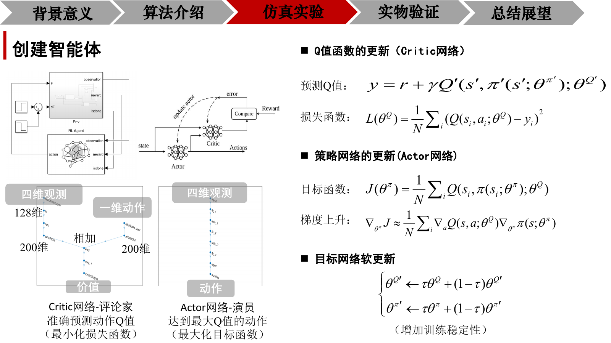
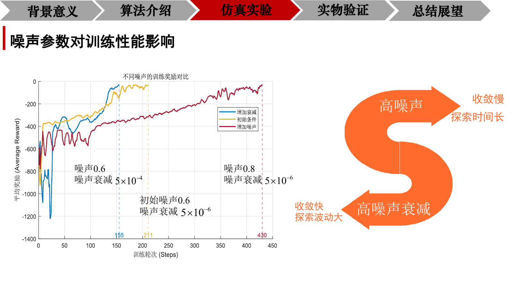
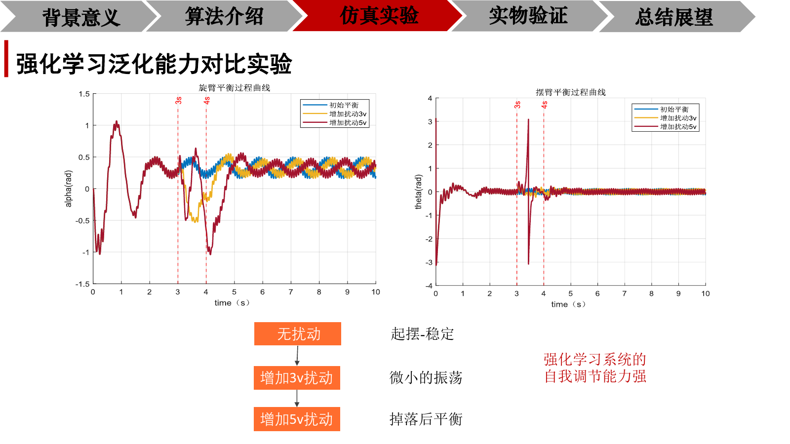
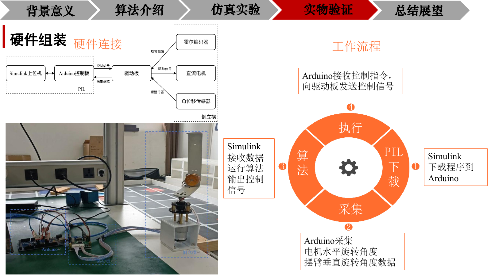
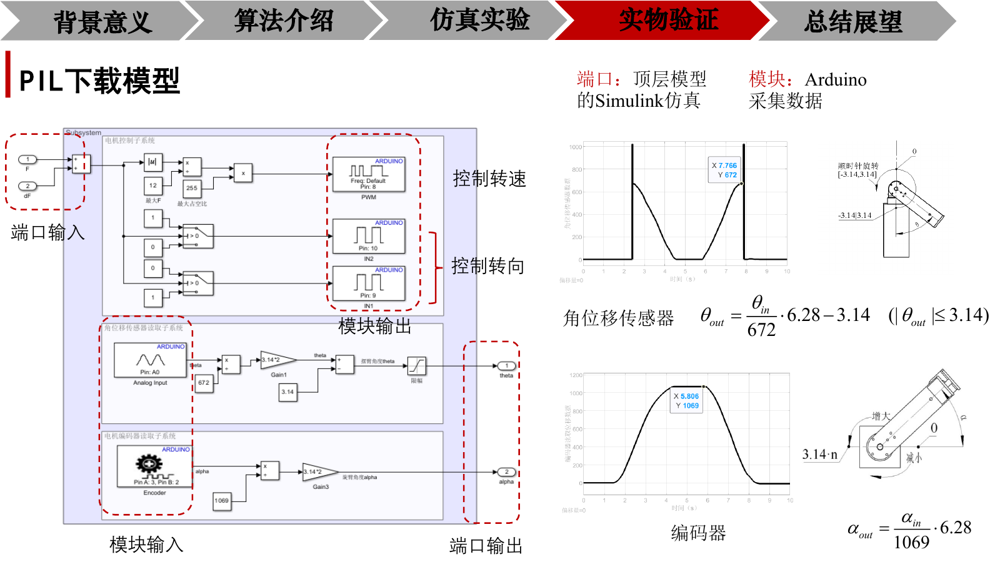
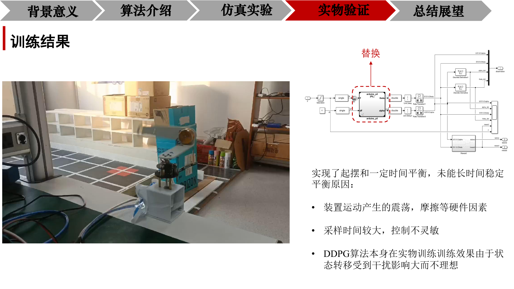

# DDPG 倒立摆控制

基于 Simulink 搭建连续状态—动作空间的一阶旋转倒立摆强化学习环境，采用 DDPG 算法实现连续控制信号输出，完成倒立摆自主起摆与稳定平衡控制，并通过 Arduino 与 PIL 完成实物闭环验证。

## 视频演示

<table>
  <tr>
    <td align="center" width="50%">
      <strong>仿真环境自主起摆与稳定控制</strong> 
      <video src="https://github.com/user-attachments/assets/5e5cadc4-cf47-4088-aaf4-c2b37ccf787d" controls muted playsinline width="100%"></video>
    </td>
    <td align="center" width="50%">
      <strong>Arduino/PIL 实物闭环控制</strong> 
      <video src="https://github.com/user-attachments/assets/bad98ee3-67cf-42e8-9e92-f21b4cf193fa" controls muted playsinline width="100%"></video>
    </td>
  </tr>
</table>

本地视频文件：[`data/sim.mp4`](data/sim.mp4)、[`data/real.mp4`](data/real.mp4)。

## 项目概述

项目以一阶旋转倒立摆为对象，围绕“仿真建模—策略训练—扰动测试—实物验证”展开：

- 在 Simscape Multibody 中建立旋臂、摆臂、关节和直流电机模型；
- 以摆杆角度、旋臂角度及对应角速度构成四维观测量，输出一维连续电机控制量；
- 采用 Actor–Critic 结构、经验回放和目标网络软更新，提高连续控制策略的训练稳定性；
- 通过探索噪声衰减和外部扰动实验，分析策略收敛性与鲁棒性；
- 结合 Arduino、驱动板、编码器和角位移传感器，完成 PIL 闭环控制验证。

## 系统建模与强化学习环境

强化学习环境由倒立摆动力学、观测子系统和奖励子系统组成。智能体接收四维观测，输出连续控制量；环境执行动作后返回下一时刻观测、奖励和终止状态。

观测向量为：

$$
s_k=[\theta_k,\dot{\theta}_k,\alpha_k,\dot{\alpha}_k]
$$

奖励函数重点惩罚摆杆偏离平衡位置、旋臂偏转、控制输入变化和角速度，并对超出安全范围的状态施加额外惩罚，使策略同时关注快速起摆、稳定平衡和控制平滑性。

  

  

## DDPG 控制策略

Actor 网络以四维观测为输入，输出一维连续动作；Critic 网络融合状态与动作，估计当前策略的 Q 值。训练过程中将交互样本存入经验回放池，随机抽取小批量样本更新网络，并采用目标网络软更新降低训练振荡：

$$
\theta'\leftarrow\tau\theta+(1-\tau)\theta'
$$

其中，Actor 通过最大化 Critic 评价值优化策略，Critic 通过最小化目标 Q 值与预测 Q 值之间的误差进行更新。

  

## 仿真测试结果

### 探索噪声与收敛性

对比不同初始噪声和噪声衰减参数可以看到：较大的探索噪声有利于扩大早期搜索范围，但会延长收敛过程；提高噪声衰减速度能够加快进入稳定策略，但需要避免过早削弱探索能力。因此，噪声初值与衰减率需要结合任务的起摆难度共同调节。

  

### 外部扰动与泛化能力

在无扰动、增加 3 V 扰动和增加 5 V 扰动三种条件下进行测试：无扰动时系统能够完成起摆并保持平衡；中等扰动下出现短时振荡后恢复；较强扰动可能造成暂时掉落，但策略仍具备重新调节并恢复平衡的能力。

  

## Arduino/PIL 实物验证

实物系统由 Simulink 上位机、Arduino 控制板、驱动板、直流电机、霍尔编码器和角位移传感器构成。PIL 工作流程为：Simulink 下载控制模型至 Arduino，Arduino 采集旋臂和摆杆角度，Simulink 运行控制策略并输出控制信号，Arduino 再将指令发送至驱动板执行。

<table>
  <tr>
    <td align="center" width="50%">
      
    </td>
    <td align="center" width="50%">
      
    </td>
  </tr>
</table>

实物测试已经实现自主起摆和一定时间的平衡控制，但长时间稳定性仍受装置振荡、摩擦、采样周期以及仿真模型与真实系统差异的影响。该结果说明仿真策略具备迁移基础，同时也明确了后续需要从采样频率、动力学建模和 sim-to-real 校准三个方向继续优化。

  

